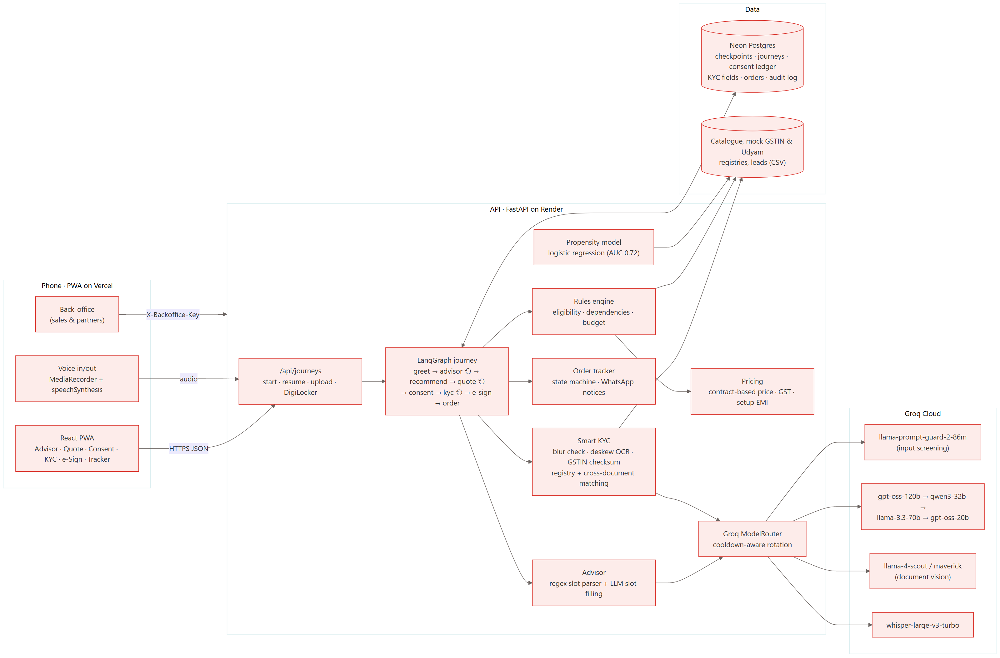
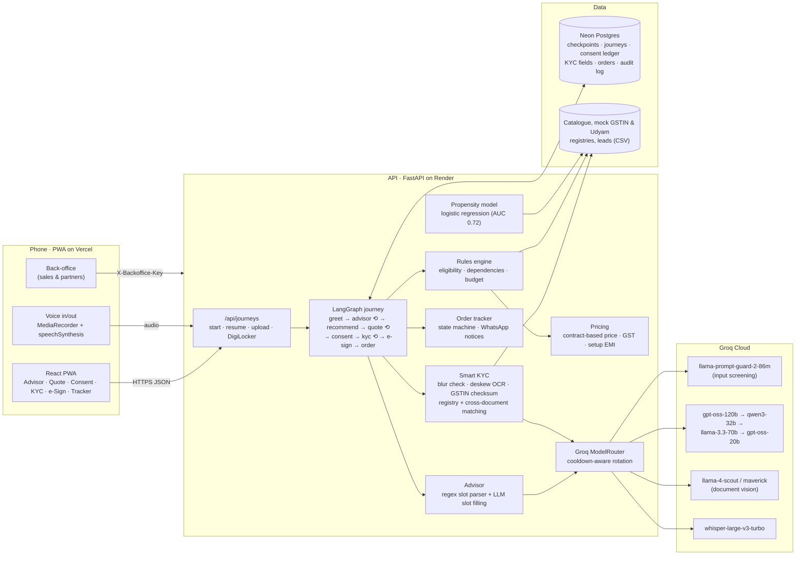
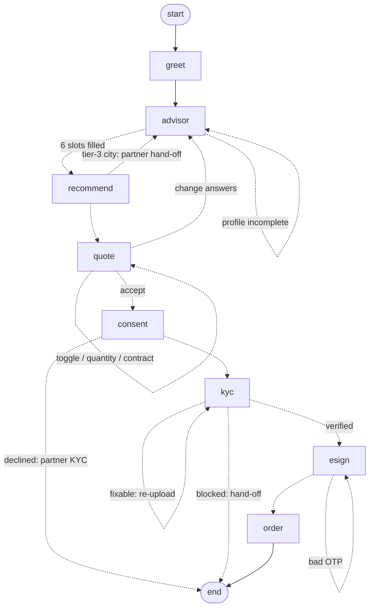

# Solution architecture

The owner uses a phone-first PWA. A FastAPI backend runs the onboarding journey as a **LangGraph state machine**. Only two steps use an LLM: the advisor conversation and document reading. Eligibility, bundle choice, pricing and order status are **deterministic code over `product_catalogue.csv`**, so prices and products are never invented.

## Components and data flows

## The journey graph

Every human step is an `interrupt()`. The API resumes the graph with `Command(resume=...)`. A journey survives restarts and device changes, because its whole state is checkpointed in Postgres under `thread_id = journey_id`.

## Improvement loop

The advisor improves from consented real use, without retraining a model:

| Signal | What it improves |
|---|---|
| Redacted advisor turns, kept with the optional "improve the advisor" consent | Similar past turns in the same language are added to the prompt as examples of how answers map to slots |
| 👍/👎 on the plan, with a reason | 👎 conversations are left out of prompt examples and exported as draft test cases for review (`/api/backoffice/learning/scenarios.yaml`) |
| Reviewed draft test cases (`tests/learned_scenarios.yaml`) | Run with the advisor scenario suite, so a fixed mistake can't come back |
| Journey outcomes (ordered, handed off, or idle for a week) | The lead propensity model retrains on them with the historic leads, every 6 hours or on demand |

Fine-tuning a small Indic model on this data is a later step, once there is real volume.

## Key design choices

| Choice | Why |
|---|---|
| **LLM talks, code decides** | Judges run live scenarios; prices and eligibility must be reproducible. The LLM extracts slots and explains *reason codes*. It never picks products. |
| **Deterministic parser runs first** | Numbers, cities, GST yes/no and needs are parsed by regex (English, Hindi, Hinglish) before the LLM. The advisor still works with no API key or when every model is rate-limited. |
| **Groq model rotation** | On a 429 the router parks that model until its `retry-after` and moves to the next one. Malformed JSON also moves to the next model. When everything is exhausted, the scripted advisor takes over. |
| **Prompt Guard as a classifier** | `llama-prompt-guard-2-86m` scores each long user message for injection. It is not a chat fallback. A local regex catches the obvious cases offline. |
| **Two KYC extractors** | Groq vision (Llama 4) is the primary reader. The offline fallback removes the pink watermark by colour, deskews (projection-profile search), runs RapidOCR and pairs label/value boxes by geometry. |
| **Checks in code, not in the model** | GSTIN mod-36 checksum and PAN structure, O/0 OCR repair that is accepted only if the checksum then passes, registry status, fuzzy name/address match, signatory role by constitution, bill age ≤ 90 days, blur score. |
| **Hybrid LangGraph** | One graph gives a resumable state, conditional routing (fixable vs blocked KYC), human-in-the-loop interrupts and a clear hand-off path to people. |
| **PWA, not a native app** | One link works on any phone, can be added to the home screen, and needs no store review. API responses are never cached by the service worker. |

## Deployment

| Piece | `dev` branch | `prod` branch |
|---|---|---|
| Frontend | Vercel preview URL | Vercel production URL |
| API | Render `udyam-api-dev` (may sleep) | Render `udyam-api`, kept warm by UptimeRobot on `/health` |
| Database | Neon branch `dev` | Neon branch `production` |

GitHub Actions runs pytest, the frontend lint and build, and a Docker build on every push or PR. A PR merges `dev → prod`.
